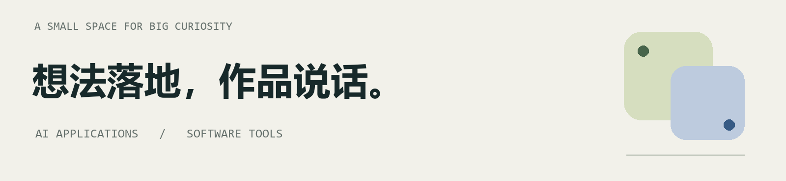
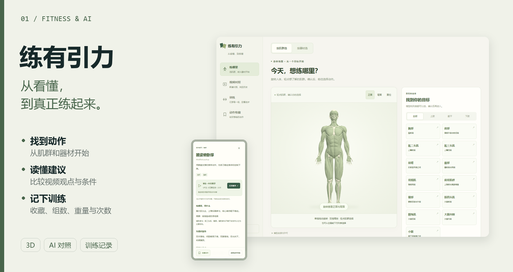
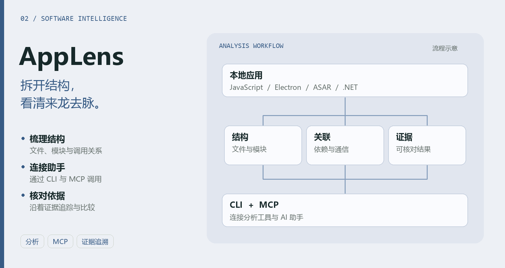
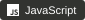
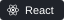
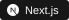
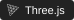
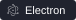

  

  <a href="#练有引力">练有引力</a> &nbsp; / &nbsp;
  <a href="#applens">AppLens</a> &nbsp; / &nbsp;
  <a href="#favorite-tools">常用工具</a> &nbsp; / &nbsp;
  <a href="#stats-and-activity">统计与动态</a> &nbsp; / &nbsp;
  <a href="https://github.com/JichaoChen1123?tab=repositories">探索全部仓库 ↗</a>

## 练有引力

**想练某块肌肉，却不知道怎么开始？收藏了很多视频，却看不清建议的差别？**

从 3D 人体或器材找到动作，把 2–3 条 B 站视频放在同一个问题下对照，展开字幕原句与时间核对；再将动作加入收藏，记录真正练过的每一组。

`React` · `TypeScript` · `Three.js` · `FastAPI` · `SQLite` · `JSON Schema`

**[查看项目 ↗](https://github.com/JichaoChen1123/favorite-clash)** &nbsp; · &nbsp; [界面与功能](https://github.com/JichaoChen1123/favorite-clash#界面预览) &nbsp; · &nbsp; [部署与使用](https://github.com/JichaoChen1123/favorite-clash#本地部署)

 

## AppLens

**给软件一副透视镜，让 AI 的分析有迹可循。**

本地软件分析工具箱：梳理 JavaScript / Electron / ASAR 的模块与通信，读取 .NET 程序集结构，通过 CLI 或 MCP 接入助手，沿着文件、关系与证据继续追问。

`TypeScript` · `Node.js` · `MCP` · `Electron / ASAR` · `.NET`

**[查看项目 ↗](https://github.com/JichaoChen1123/app-lens)** &nbsp; · &nbsp; [安装指南](https://github.com/JichaoChen1123/app-lens#windows-快速开始) &nbsp; · &nbsp; [MCP 接入](https://github.com/JichaoChen1123/app-lens#连接-ai-助手) &nbsp; · &nbsp; [使用文档](https://github.com/JichaoChen1123/app-lens/blob/main/docs/index.md)

 

<!-- Tool badge icons: Simple Icons (CC0), https://github.com/simple-icons/simple-icons -->

<h2>🛠️ My Favorite Tools</h2>

<h3>👨‍💻 Programming and Markup Languages</h3>

  
  
  
  
  

<h3>🧰 Frameworks and Libraries</h3>

  
  
  
  
  
  

<h3>🤖 AI and Model Tools</h3>

  
  
  
  

<h3>🗄️ Databases and Retrieval</h3>

  
  
  
  
  

<h3>💻 Development and Testing</h3>

  
  
  
  
  

<h2>📊 Stats and Activity</h2>

<h3>💻 GitHub Profile Stats</h3>

  
  

语言分布反映公开仓库的代码构成，不含 AppLens。

<h3>⚡ Recent GitHub Activity</h3>

- 2026-10-20 · 更新 [app-lens](https://github.com/JichaoChen1123/app-lens) · [`235fb9c`](https://github.com/JichaoChen1123/app-lens/commit/235fb9c1b82f9bf126b0869b80ddca8ba1ab881d)
- 2026-10-19 · 更新 [favorite-clash](https://github.com/JichaoChen1123/favorite-clash) · [`b86a68c`](https://github.com/JichaoChen1123/favorite-clash/commit/b86a68c0b9b00c53ca82081f7cc17c3a5b202816)
- 2026-10-19 · 更新 [favorite-clash](https://github.com/JichaoChen1123/favorite-clash) · [`dcf6f34`](https://github.com/JichaoChen1123/favorite-clash/commit/dcf6f34698817ce3a0ab037497f1a0a43f20bbc6)

公开动态快照 · 2026-10-20 · <a href="https://github.com/JichaoChen1123?tab=overview">查看实时动态 ↗</a>

 

---

BUILD THINGS. STAY CURIOUS.

