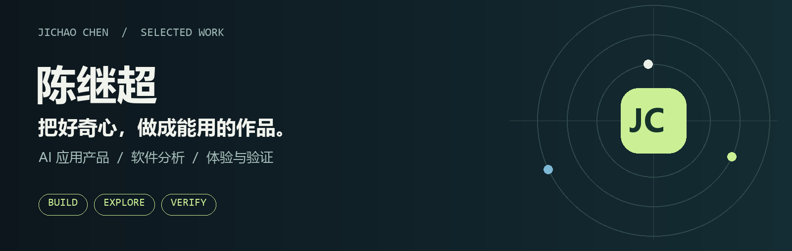
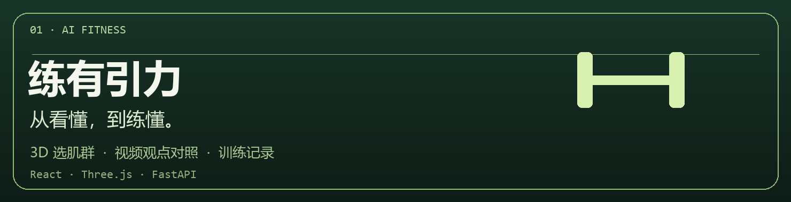
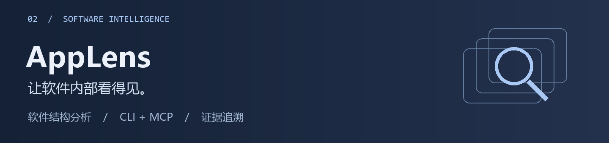

<p align="center">
  
</p>

<p align="center">
  <a href="#关于我">关于我</a> &nbsp;·&nbsp;
  <a href="#代表作品">代表作品</a> &nbsp;·&nbsp;
  <a href="#综合能力">综合能力</a> &nbsp;·&nbsp;
  <a href="#更多探索">更多探索</a> &nbsp;·&nbsp;
  <a href="https://github.com/JichaoChen1123?tab=repositories">全部仓库 ↗</a>
</p>

## 关于我

人工智能专业背景，做 **AI 应用产品** 和 **面向助手的软件分析工具**。

习惯从真实使用场景出发：先把问题拆成可验证的功能与交互，再接入模型、工具链和测试反馈，持续改进「能不能用」和「结果能不能核对」。

当前投入最多的，是 **练有引力**（健身 × AI）和 **AppLens**（软件结构 × MCP）。

---

<h2 id="代表作品">代表作品</h2>

<h3 id="练有引力">练有引力</h3>

<a href="https://github.com/JichaoChen1123/favorite-clash">
  
</a>

**把健身视频、动作教学和训练记录连起来的 AI 健身应用。**

| 你在纠结什么 | 产品怎么帮 |
| :--- | :--- |
| 想练某块肌肉，不知道选什么动作 | 旋转 3D 人体选肌群，或从器材进入动作页，看步骤、常见错误与教学视频 |
| 收藏很多视频，观点却互相打架 | 对照 2–3 条 B 站视频，区分观点与适用条件；展开字幕原句、时间与前后文核对 |
| 收藏了动作，却很少真的开练 | 收藏与训练衔接，从已收藏动作开始记组数、重量与完成情况 |

<p>
  
</p>

<p align="center">
  
  &nbsp;
  
</p>

`React` · `TypeScript` · `Three.js` · `FastAPI` · `SQLite` · `JSON Schema`

**[仓库 ↗](https://github.com/JichaoChen1123/favorite-clash)** · [界面预览](https://github.com/JichaoChen1123/favorite-clash#界面预览) · [本地部署](https://github.com/JichaoChen1123/favorite-clash#本地部署)

<br />

<h3 id="applens">AppLens</h3>

<a href="https://github.com/JichaoChen1123/app-lens">
  
</a>

**面向开发者和 AI 助手的本地软件分析工具箱：结构可读、结论可核对。**

| 能力 | 说明 |
| :--- | :--- |
| **读懂结构** | 分析 JavaScript / Electron / ASAR，梳理模块与跨进程通信；读取 .NET 程序集结构 |
| **接入助手** | 命令行或 MCP 调用，让 AI 围绕具体文件、模块与证据继续追问 |
| **证据闭环** | 追踪功能、比较版本、导入导出证据；外部分析引擎按环境接入 |

`TypeScript` · `Node.js` · `MCP` · `Electron / ASAR` · `.NET`

**[仓库 ↗](https://github.com/JichaoChen1123/app-lens)** · [Windows 快速开始](https://github.com/JichaoChen1123/app-lens#windows-快速开始) · [MCP 接入](https://github.com/JichaoChen1123/app-lens#连接-ai-助手) · [命令与证据](https://github.com/JichaoChen1123/app-lens/blob/main/docs/cli.md)

---

## 综合能力

| 方向 | 我通常负责什么 |
| :--- | :--- |
| **产品与体验** | 场景拆解、功能流程、多端交互、原型验证与异常反馈 |
| **AI 与质量** | Prompt / 上下文设计、JSON Schema 约束、RAG 与 MCP 接入、结果可核对 |
| **工程实现** | Python / TypeScript 全栈、FastAPI / Node、SQLite、测试与 CI、Windows 本地工具链 |

```text
典型推进方式：问题 → 可演示原型 → 接口与数据约束 → 真实使用反馈 → 迭代
```

**常用技术：** `Python` · `TypeScript` · `React` · `Next.js` · `FastAPI` · `Node.js` · `Three.js` · `Docker` · `Git`

---

## 更多探索

也在维护或迭代这些方向，和上面两个项目共用同一套「能跑起来、能核对」的标准：

| 项目 | 方向 |
| :--- | :--- |
| [**RAGOps**](https://github.com/JichaoChen1123/RAGOps) | 模型与 Prompt 评测：数据集版本、指标、失败诊断与报告 |
| [**源答**](https://github.com/JichaoChen1123/yuanda-rag-assistant) | 帮助文档问答：混合检索、重排与引用展示 |
| [**知页**](https://github.com/JichaoChen1123/zhiye-ai-study) | 文档学习：连续问答、闪卡与测验 |

<br />

<p align="center">
  <b>有趣的想法，值得做成真正能用的东西。</b><br /><br />
  <a href="https://github.com/JichaoChen1123?tab=repositories">探索全部仓库 ↗</a>
</p>
